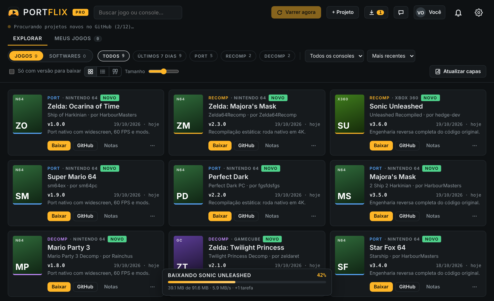
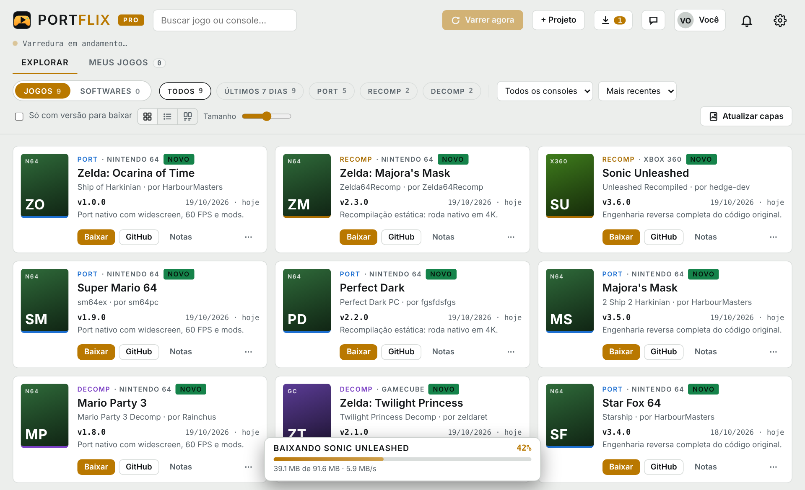
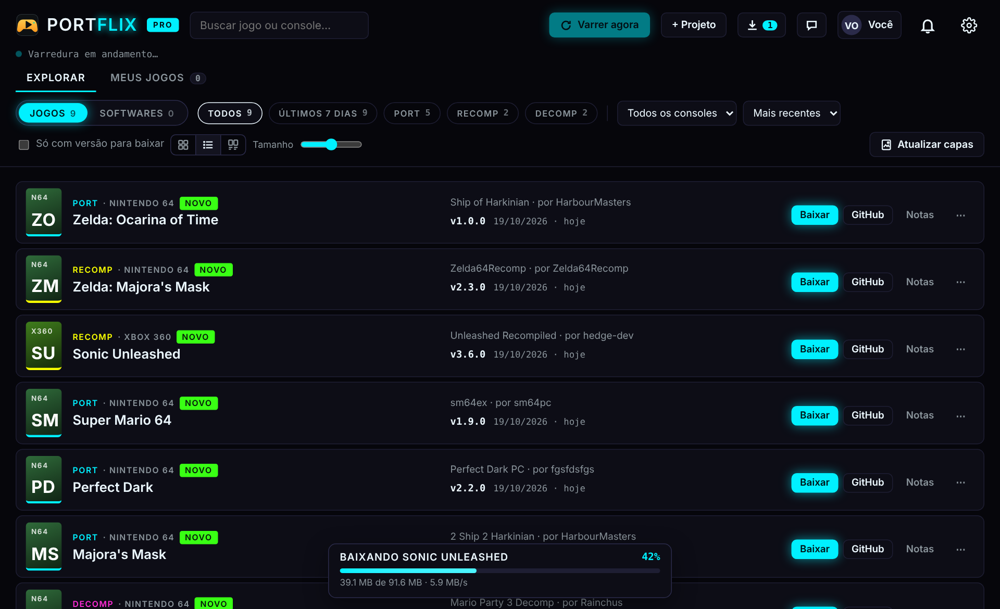
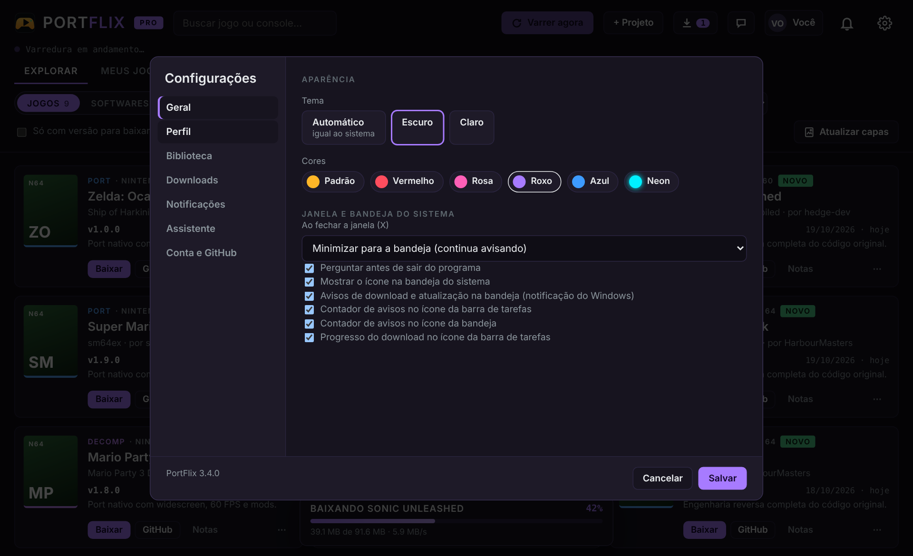

<p align="center">
  
</p>

<h1 align="center">PortFlix</h1>

<p align="center">
  Todos os <b>ports, recomps e decomps</b> de jogos feitos por fãs, num lugar só.<br>
  Every fan-made <b>PC port, recomp and decomp</b> of console games, in one place.
</p>

<p align="center">
  <a href="https://github.com/Isago2508/PortFlix/releases/latest"></a>
  <a href="https://github.com/Isago2508/PortFlix/releases"></a>
  
  <a href="https://discord.gg/XusPwTQ6X"></a>
</p>

<p align="center">
  <a href="https://github.com/Isago2508/PortFlix/releases/latest/download/PortFlix-Setup.exe"></a>
  <a href="https://github.com/Isago2508/PortFlix/releases/latest/download/PortFlix-Linux-x86_64.tar.gz"></a>
</p>

<p align="center"><b><a href="https://isago2508.github.io/PortFlix/">🌐 Site / Website</a> · <a href="https://isago2508.github.io/PortFlix/conta.html">PRO vitalício / lifetime: 1 PC R$ 30 · 2 PCs R$ 50</a></b></p>

<p align="center">
  
</p>

<p align="center"><b>Escolha o idioma abaixo · Choose your language below</b></p>

<details open>
<summary><h2>🇧🇷 Português</h2></summary>

### O que é

O PortFlix é um catálogo que se atualiza sozinho com os projetos da comunidade que trazem jogos de console para o PC, como Ship of Harkinian, Zelda64Recomp, sm64 e recomps de Xbox 360, PS2 e outros. Ele varre o GitHub e listas da comunidade, mostra capas, avisa quando sai versão nova e organiza os jogos que você já tem.

> **O PortFlix não inclui nem distribui jogos.** Os ports pedem a sua própria cópia original (ROM, ISO ou arquivos do console). Os créditos de cada projeto são dos seus criadores: em cada jogo do app aparecem o autor e o link do repositório original.

### Funções

| | Free | PRO |
|---|:-:|:-:|
| Catálogo de ports, recomps e decomps | ✅ 1x por dia | ✅ a cada hora ou quando quiser |
| Avisos de versão nova | ✅ 24 h depois | ✅ **na hora** |
| Aba **Softwares** e capas automáticas | ✅ | ✅ |
| **Meus jogos** | ✅ até 5 | ✅ ilimitado |
| Tema claro ou escuro, bandeja do sistema, aviso de atualização do app | ✅ | ✅ |
| Filtros por console, ordem e "Últimos 7 dias"; escolher a capa à mão | – | ✅ |
| **Favoritos e listas** (Quero jogar, Jogando agora, Zerados) | – | ✅ |
| **Tempo de jogo** de cada port | – | ✅ |
| **Modo TV** com controle (estilo Big Picture) | – | ✅ |
| **Página do jogo**: imagens, novidades traduzidas, vídeos | – | ✅ |
| **Baixar dentro do app**, com barra de progresso e extração | – | ✅ |
| **Assistente com IA** grátis incluso | – | ✅ |
| **Arquivo do jogo original** na pasta certa | – | ✅ |
| **Sincronizar entre PCs**, exportar e importar a biblioteca | – | ✅ |
| **Pendrive (modo técnico)**: leve os ports para outro PC | – | ✅ |
| Widget de lançamentos na bandeja (Windows) | – | ✅ |
| Cores de tema: vermelho, rosa, roxo, azul e neon | – | ✅ |
| Projetos próprios, seguir criadores e conectar o GitHub | – | ✅ |

**PRO vitalício:** 1 PC por **R$ 30** ou 2 PCs por **R$ 50**, pagamento único. Compre no [site](https://isago2508.github.io/PortFlix/#precos) (Mercado Pago ou Pix pelo WhatsApp).

¹ As capas automáticas são buscadas pelo nome do jogo e **nem sempre vão bater com o jogo certo**. No PRO você troca qualquer capa do jeito que quiser: uma sugestão, um link de imagem ou um arquivo do seu PC.

O app é o mesmo para todo mundo: ele abre como **Free** e vira **PRO** quando você ativa uma chave.

### Novidades

Veja o que mudou em cada versão no **[histórico de novidades](CHANGELOG.md)**. O próprio PortFlix avisa quando sai versão nova e atualiza em **Configurações → Atualizações**.

### Telas

<table>
  <tr>
    <td></td>
    <td></td>
  </tr>
  <tr>
    <td align="center">Tema claro</td>
    <td align="center">Modo lista · cor Neon (PRO)</td>
  </tr>
  <tr>
    <td colspan="2"></td>
  </tr>
  <tr>
    <td colspan="2" align="center">Configurações em seções: temas, bandeja do sistema, notificações e mais</td>
  </tr>
</table>

### Download

Baixe em **[Releases](https://github.com/Isago2508/PortFlix/releases/latest)**:

| Sistema | Arquivo |
|---|---|
| Windows 10 / 11 | `PortFlix-Setup.exe` |
| Linux (x86_64: a maioria dos PCs e o Steam Deck) | `PortFlix-Linux-x86_64.tar.gz` |
| Linux ARM64 (Raspberry Pi e similares) | `PortFlix-Linux-arm64.tar.gz` |
| Android 8+ (celular e tablet, 64 bits) | `PortFlix-Android.apk` |

#### Windows

1. Abra o `PortFlix-Setup.exe`.
2. Se aparecer **"O Windows protegeu o computador"**, clique em **Mais informações → Executar assim mesmo**. O aviso aparece porque o PortFlix é um programa novo e ainda não tem assinatura digital. Não é vírus.
3. Leia e aceite os termos, escolha a pasta (o padrão é `C:\PortFlix`) e pronto.

Para desinstalar, use **Configurações do Windows → Aplicativos → PortFlix**. Ao instalar uma versão nova, o instalador oferece atualizar mantendo as suas capas e jogos.

> Precisa do Microsoft Edge WebView2, que já vem no Windows 11 e na maioria dos Windows 10.

#### Linux

```bash
tar -xzf PortFlix-Linux-x86_64.tar.gz
cd PortFlix
./instalar.sh
```

O PortFlix entra no menu de aplicativos, em **Jogos**. Ele abre numa janela própria usando o Chrome, Chromium, Brave, Edge ou Vivaldi. Sem nenhum deles, abre no seu navegador padrão.

- **Jogos que só têm versão para Windows:** o app abre pelo **Wine**, se ele estiver instalado. Outra opção é adicionar o jogo ao Steam como "jogo não Steam" e ativar o Proton.
- **Programas opcionais:** `zenity` ou `kdialog` (janela para escolher pastas), `wl-clipboard` ou `xclip` (copiar texto).
- **Instalador:** dois cliques no `instalar.sh` abrem o mesmo instalador do Windows (pasta, atalhos, atualizar ou desinstalar).
- **Desinstalar:** botão direito no PortFlix no menu de aplicativos → **Desinstalar o PortFlix**, ou rode o `instalar.sh` de novo.

#### Android

1. Baixe o `PortFlix-Android.apk` no celular e toque nele.
2. Se o Android pedir, libere **"instalar apps desconhecidos"** para o navegador ou o gerenciador de arquivos.
3. Abra o PortFlix.

No Android, o catálogo mostra **só os ports que têm APK para Android**. No PRO, o app baixa e instala o APK sozinho (na primeira vez, o Android pede a mesma liberação para o PortFlix). A chave PRO é a mesma do PC: o celular ocupa uma vaga da chave.

### Ativar o PRO

1. Compre a sua chave com o vendedor. Informe o **e-mail da conta Google, Hotmail ou Outlook** que você vai usar.
2. No PortFlix, clique em **Ativar PRO** (canto superior direito).
3. Entre com **a mesma conta do e-mail informado na compra**. Com outra conta, a ativação não funciona.
4. Cole a chave (`PRADAR-XXXXX-XXXXX-XXXXX-XXXXX`) e clique em **Ativar**.

**Como funciona a licença:**
- **Validade:** a chave vale pelo prazo comprado e conta a partir da ativação.
- **Computadores:** cada chave vale para um número de PCs. Para trocar de computador, use **Sua licença → Remover licença deste PC** antes, ou peça ao vendedor para liberar a vaga.
- **Sem internet:** o app confere a licença de tempos em tempos e funciona até **7 dias** sem internet.
- **Perfil:** em **Configurações → Perfil** você atualiza o seu nome, apelido, data de nascimento, telefone e cidade.

### Dicas

- **Arquivo do jogo original:** no **⋯** de um jogo, escolha a ROM ou ISO que **você extraiu do seu próprio cartucho ou disco**. Se o port pedir, informe também o nome do arquivo (por exemplo `baserom.us.z64`). O PortFlix coloca o arquivo na pasta do jogo sempre que você instala ou atualiza. A janela tem um link para o guia de como extrair o jogo do seu console.
- **Criadores que sigo:** em Configurações, siga qualquer usuário ou organização do GitHub. Todos os projetos dessa pessoa entram no catálogo.
- **Assistente:**
  - O assistente grátis já vem incluso no PRO, com um limite de mensagens por dia.
  - Para conversar sem limite, use a sua própria chave em **Configurações → Assistente**. O Gemini tem cota gratuita.
  - O assistente não indica onde baixar jogos.
- **Modo TV:** clique no ícone da TV no topo. Navegue com as setas ou com o controle; **A/Enter** abre e **B/Esc** sai.
- **Pendrive:** em Meus jogos → **Pendrive…**, copie os jogos para um pendrive e, no outro PC, use **Instalar a partir do pendrive**.
- **Atalhos:** `F5` varre de novo e `Ctrl+F` busca.

### Privacidade

O PortFlix guarda as suas configurações só no seu computador. Para ativar o PRO, o servidor de licenças recebe:
- o **nome** e o **e-mail** da conta com que você entrou;
- um **código do computador**, que não identifica você.

Ele não acessa os seus e-mails, arquivos nem contatos. Política completa: https://portsradar-licencas.portsradar-hugo.workers.dev/privacidade

### Termos de uso

- **Uso pessoal.** O PortFlix serve para reunir, num lugar só, os projetos da comunidade.
- **Os créditos são dos criadores.** Cada port pertence a quem o desenvolveu. O PortFlix não é autor de nenhum desses projetos nem tem ligação com eles. Apoie os criadores pelos links de cada projeto.
- **Nada de jogos.** O app não inclui, não busca e não distribui ROMs, ISOs ou arquivos de jogos.
- **Marcas** de jogos, consoles e empresas pertencem aos seus donos. O PortFlix não é ligado nem aprovado pela Nintendo, Sony, Microsoft, Sega ou outras empresas.
- **Sem garantia.** Os ports são projetos de fãs, muitas vezes em desenvolvimento. Use por sua conta.
- O PRO cobra pelas **funções do aplicativo**, nunca pelos jogos ou pelos ports.

**É criador de um port e não quer o seu projeto no catálogo?** Abra uma *issue* ou mande um e-mail que ele é removido.

### Suporte

- **Discord:** [comunidade do PortFlix](https://discord.gg/XusPwTQ6X) (ainda em construção)
- **WhatsApp:** [(48) 98851-6188](https://wa.me/5548988516188)
- **E-mail:** hugofernandes30@gmail.com
- **Problemas e sugestões:** use a aba [Issues](https://github.com/Isago2508/PortFlix/issues)

</details>

<details>
<summary><h2>🇺🇸 English</h2></summary>

### What it is

PortFlix is a self-updating catalog of the community projects that bring console games to the PC, like Ship of Harkinian, Zelda64Recomp, sm64 and Xbox 360, PS2 and N64 recomps. It scans GitHub and community lists, finds covers, tells you when a new version is out and organizes the games you already have.

> **PortFlix does not include or distribute games.** Ports require your own original copy (ROM, ISO or console files). Every project belongs to its creators: each game in the app shows the author and a link to the original repository.

> **Language:** the app interface is currently in Brazilian Portuguese. The website, this page and the release notes are available in English and Portuguese.

### Features

| | Free | PRO |
|---|:-:|:-:|
| Catalog of ports, recomps and decomps | ✅ once a day | ✅ every hour or whenever you want |
| New version alerts | ✅ 24 h later | ✅ **instantly** |
| **Software** tab and automatic covers¹ | ✅ | ✅ |
| **My games** | ✅ up to 5 | ✅ unlimited |
| Light or dark theme, system tray, app update alerts | ✅ | ✅ |
| Filters by console, sorting and "Last 7 days"; pick covers by hand | – | ✅ |
| **Favorites and lists** (Want to play, Playing now, Finished) | – | ✅ |
| **Play time** for each port | – | ✅ |
| **TV Mode** with controller support (Big Picture style) | – | ✅ |
| **Game page**: screenshots, translated patch notes, videos | – | ✅ |
| **Download inside the app**, with progress bar and extraction | – | ✅ |
| Free **AI Assistant** included | – | ✅ |
| **Original game file** placed in the right folder | – | ✅ |
| **Sync between PCs**, export and import your library | – | ✅ |
| **USB drive (technician mode)**: take your ports to another PC | – | ✅ |
| Latest releases widget in the tray (Windows) | – | ✅ |
| Theme colors: red, pink, purple, blue and neon | – | ✅ |
| Your own projects, follow creators and connect GitHub | – | ✅ |

**PRO for life:** 1 PC for **R$ 30** or 2 PCs for **R$ 50** (Brazilian reais), one-time payment. Buy it on the [website](https://isago2508.github.io/PortFlix/?lang=en#pricing) (Mercado Pago) or [message us on WhatsApp](https://wa.me/5548988516188) to pay another way.

¹ Automatic covers are found by the game's name and **won't always match the right game**. With PRO you can swap any cover however you like: a suggestion, an image link or a file from your PC.

The app is the same for everyone: it opens as **Free** and becomes **PRO** when you activate a key.

### What's new

See what changed in each version in the **[CHANGELOG](CHANGELOG.md)**. PortFlix itself tells you when a new version is out and updates from **Configurações → Atualizações** (Settings → Updates).

### Screenshots

<table>
  <tr>
    <td></td>
    <td></td>
  </tr>
  <tr>
    <td align="center">Light theme</td>
    <td align="center">List view · Neon color (PRO)</td>
  </tr>
  <tr>
    <td colspan="2"></td>
  </tr>
  <tr>
    <td colspan="2" align="center">Settings organized in sections: themes, system tray, notifications and more</td>
  </tr>
</table>

### Download

Get it from **[Releases](https://github.com/Isago2508/PortFlix/releases/latest)**:

| System | File |
|---|---|
| Windows 10 / 11 | `PortFlix-Setup.exe` |
| Linux (x86_64: most PCs and the Steam Deck) | `PortFlix-Linux-x86_64.tar.gz` |
| Linux ARM64 (Raspberry Pi and similar) | `PortFlix-Linux-arm64.tar.gz` |
| Android 8+ (phones and tablets, 64-bit) | `PortFlix-Android.apk` |

#### Windows

1. Run `PortFlix-Setup.exe`.
2. If you see **"Windows protected your PC"**, click **More info → Run anyway**. The warning shows up because PortFlix is a new program without a digital signature yet. It is not a virus.
3. Read and accept the terms, choose the folder (default `C:\PortFlix`) and you're done.

To uninstall, use **Windows Settings → Apps → PortFlix**. When you install a new version, the installer offers to update while keeping your covers and games.

> Requires Microsoft Edge WebView2, which already comes with Windows 11 and most Windows 10 installs.

#### Linux

```bash
tar -xzf PortFlix-Linux-x86_64.tar.gz
cd PortFlix
./instalar.sh
```

PortFlix shows up in your app menu under **Games**. It opens in its own window using Chrome, Chromium, Brave, Edge or Vivaldi. Without any of them, it opens in your default browser.

- **Windows-only games:** the app opens them with **Wine**, if installed. You can also add the game to Steam as a "non-Steam game" and enable Proton.
- **Optional tools:** `zenity` or `kdialog` (folder picker), `wl-clipboard` or `xclip` (copy text).
- **Installer:** double-click `instalar.sh` to open the same installer as on Windows (folder, shortcuts, update or uninstall).
- **Uninstall:** right-click PortFlix in the app menu → **Desinstalar o PortFlix**, or run `instalar.sh` again.

#### Android

1. Download `PortFlix-Android.apk` on your phone and tap it.
2. If Android asks, allow **"install unknown apps"** for the browser or file manager.
3. Open PortFlix.

On Android, the catalog shows **only the ports that have an Android APK**. On PRO, the app downloads and installs the APK by itself (the first time, Android asks for the same permission for PortFlix). The PRO key is the same as on your PC: the phone takes one slot of the key.

### Activating PRO

1. Buy your key and give the **Google, Hotmail or Outlook e-mail** you are going to use.
2. In PortFlix, click **Ativar PRO** (top right corner).
3. Sign in with **the same e-mail used for the purchase**. With another account, activation won't work.
4. Paste the key (`PRADAR-XXXXX-XXXXX-XXXXX-XXXXX`) and click **Ativar**.

**How the license works:**
- **Lifetime:** keys sold on the website never expire.
- **Computers:** each key is valid for 1 or 2 PCs. To switch computers, use **Sua licença → Remover licença deste PC** first, or ask us to free the slot.
- **Offline:** the app checks the license from time to time and works up to **7 days** without internet.

### Tips

- **Original game file:** in a game's **⋯** menu, pick the ROM or ISO that **you dumped from your own cartridge or disc**. PortFlix places it in the game folder every time you install or update.
- **Followed creators:** in Settings, follow any GitHub user or organization and all their projects join the catalog.
- **Assistant:** the free assistant comes with PRO, with a daily message limit. For unlimited use, add your own key (Gemini has a free tier). The assistant never points to game downloads.
- **TV Mode:** click the TV icon at the top. Use the arrow keys or a controller; **A/Enter** opens and **B/Esc** exits.
- **USB drive:** in My games → **Pendrive…**, copy your games to a USB drive and, on the other PC, use **Install from USB drive**.
- **Shortcuts:** `F5` scans again and `Ctrl+F` searches.

### Privacy

PortFlix keeps your settings on your own computer. To activate PRO, the license server receives:
- the **name** and **e-mail** of the account you signed in with;
- a **computer code** that does not identify you.

It never accesses your e-mails, files or contacts. Full policy (Portuguese): https://portsradar-licencas.portsradar-hugo.workers.dev/privacidade

### Terms of use

- **Personal use.** PortFlix gathers community projects in one place.
- **Credit goes to the creators.** Each port belongs to whoever made it. PortFlix is not the author of these projects and is not affiliated with them. Support the creators through each project's links.
- **No games.** The app does not include, search for or distribute ROMs, ISOs or game files.
- **Trademarks** of games, consoles and companies belong to their owners. PortFlix is not affiliated with or endorsed by Nintendo, Sony, Microsoft, Sega or any other company.
- **No warranty.** Ports are fan projects, often in development. Use at your own risk.
- PRO charges for the **app features**, never for games or ports.

**Are you a port creator and don't want your project in the catalog?** Open an *issue* or send an e-mail and it will be removed.

### Support

- **Discord:** [PortFlix community](https://discord.gg/XusPwTQ6X) (still a work in progress)
- **WhatsApp:** [+55 48 98851-6188](https://wa.me/5548988516188)
- **E-mail:** hugofernandes30@gmail.com
- **Bugs and suggestions:** [Issues](https://github.com/Isago2508/PortFlix/issues)

</details>
